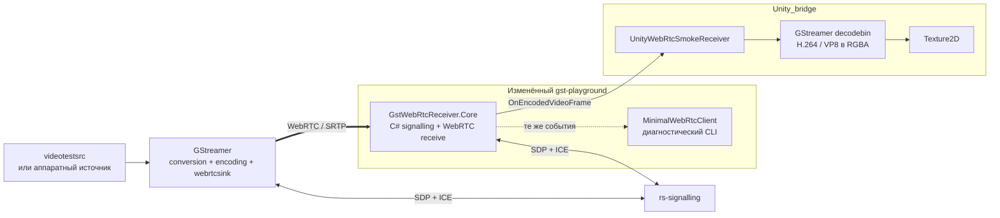

# gst-playground — GStreamer sender и C# WebRTC receiver

В этой ветке исходный GStreamer WebRTC playground дополнен C#-клиентом для Unity. GStreamer остаётся медиадвижком: он формирует и кодирует поток, а Unity декодирует принятые access units через отдельный GStreamer bridge.

## Текущая реализация

- Добавлена библиотека `GstWebRtcReceiver.Core` для signalling, SDP, ICE, DTLS/SRTP и приёма RTP на C#.
- Добавлен диагностический консольный клиент `MinimalWebRtcClient`.
- H.264 constrained baseline выбран основным кодеком; VP8 оставлен запасным вариантом.
- Добавлено публичное событие `OnEncodedVideoFrame`, поэтому Unity получает закодированные кадры без reflection.
- Producer в `docker-compose.yml` настроен на H.264 constrained baseline.
- Проверен полный путь от `webrtcsink` через C#-приёмник до GStreamer-декодера и текстуры Unity 640×480.

## Архитектура эксперимента



## Где именно используется GStreamer

- `webrtcsink` создаёт WebRTC sender и отправляет media;
- входной pipeline выполняет подготовку и кодирование видео;
- `rs-signalling` из `gst-plugins-rs` обслуживает установление сессии;
- в Unity `GstVideoDecoderBridge` использует `appsrc`, codec parser, `decodebin`, `videoconvert` и `appsink`.

C# не заменяет медиапайплайн. `GstWebRtcReceiver.Core` отвечает за протокол WebRTC на принимающей стороне и передаёт собранные encoded access units в GStreamer decoder.

## Кодеки

Основная конфигурация использует H.264 constrained baseline:

- SDP profile: constrained baseline `42c0xx` (receiver capability `42c015`, тест 640×480 согласовал `42c01e`);
- RTP packetization mode: `1`;
- причина выбора: профиль соответствует аппаратно поддерживаемому пути целевой системы.

VP8 остаётся запасным кодеком для программной проверки. В списке возможностей receiver H.264 указан первым.

## Изменённые компоненты

### `csharp/GstWebRtcReceiver.Core/`

Повторно используемая `net8.0`/`netstandard2.1` библиотека:

- подключение к `rs-signalling`;
- SDP и ICE;
- DTLS/SRTP и WebRTC peer connection;
- подсчёт входящих RTP-пакетов;
- публичные события состояния;
- публичное `OnEncodedVideoFrame` без доступа Unity к приватным полям receiver.

### `csharp/MinimalWebRtcClient/`

Консольная проверка signalling, negotiation, ICE, DTLS/SRTP и входящего RTP без запуска Unity.

### `docker-compose.yml`

Поднимает `rs-signalling`, GStreamer producer и при необходимости C# client. Producer запрашивает `video/x-h264,profile=constrained-baseline`.

## Быстрая проверка

```bash
docker compose up --build rs-signalling gst-producer csharp-client
```

Для локально установленного runtime можно запустить signalling server и producer отдельно, затем выполнить:

```bash
dotnet run --project csharp/MinimalWebRtcClient -- \
  --signalling ws://localhost:8443 \
  --timeout 45 \
  --observe 5
```

Успешная проверка должна подтвердить negotiated H.264, ICE connected и поступление video RTP packets.

Проверенный запуск согласовал H.264 constrained baseline `42c01e`, payload type 96, активировал DTLS/SRTP и принял 144 RTP-пакета за пятисекундное окно наблюдения. Отдельная интеграционная проверка передала собранный `OnEncodedVideoFrame` в GStreamer и получила RGBA 640×480.
